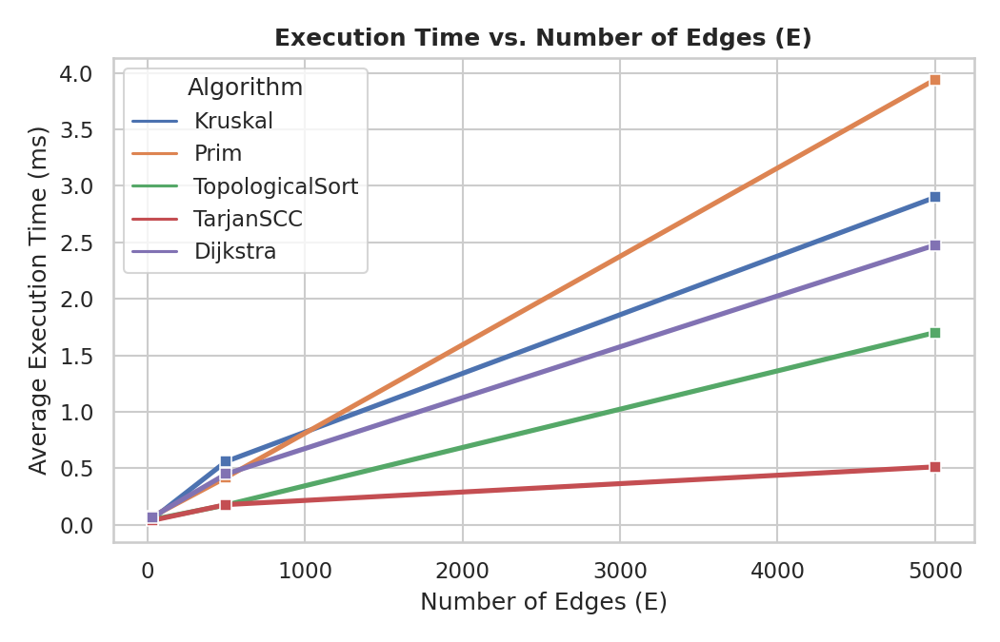
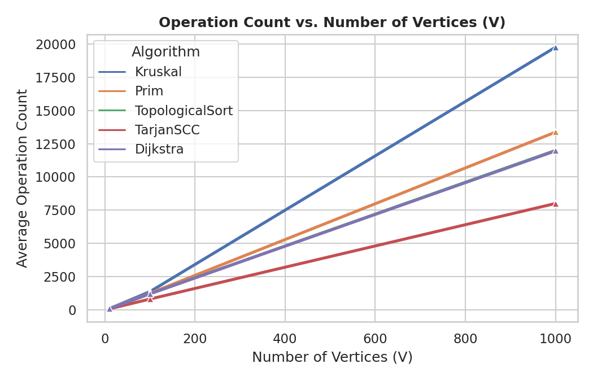
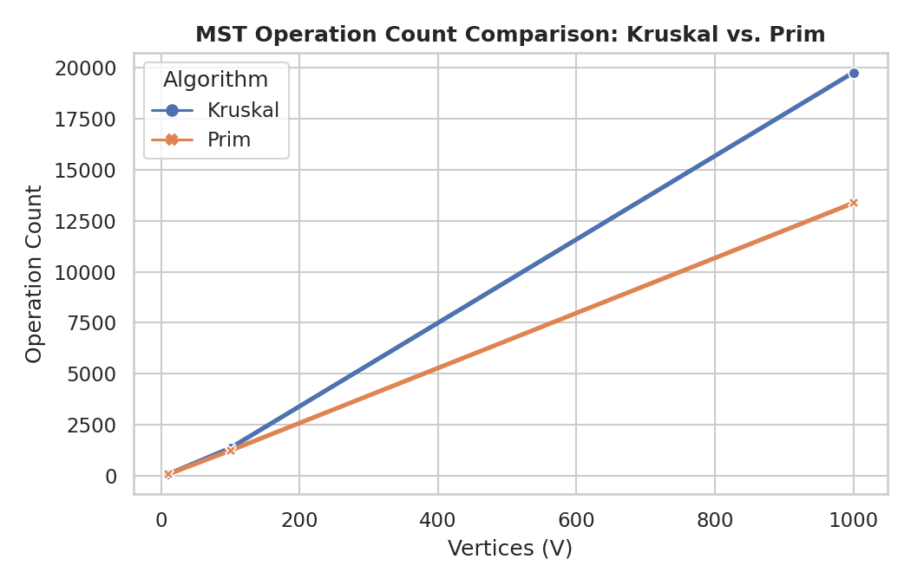

# Smart City Infrastructure and Route Planning

## Overview
This application models a smart city's infrastructure network using graph algorithms in Java. The city structure is represented as a weighted graph:
- **Vertices ($V$)**: Represent city districts or key infrastructure hubs.
- **Edges ($E$)**: Represent roads or direct connections between locations.
- **Weights**: Represent construction costs or physical distances depending on the task.

The project provides three primary operational modules:
1. **Infrastructure Planning (MST)**: Finds the minimal-cost connectivity network using Kruskal's and Prim's algorithms.
2. **Connectivity & Dependent Routing**: Determines topological ordering for DAGs, detects cycle conflicts, and calculates Strongly Connected Components (SCC) using Tarjan's algorithm.
3. **Shortest Route Planning**: Computes optimal paths from a source district to all reachable locations using Dijkstra's algorithm.

---

## Implementation
The repository is organized following standard package structure requirements:

```text
assignment-3/
├── src/
│   ├── graph/           # Base Graph model (adjacency list), Edge class, GraphGenerator
│   ├── dsu/             # Disjoint Set Union implementation
│   ├── mst/             # Kruskal's and Prim's algorithms
│   ├── connectivity/    # Topological Sort and Tarjan's SCC
│   ├── shortestpath/    # Dijkstra's algorithm
│   └── Main.java        # Benchmarking suite & correctness test runner
├── results/
│   ├── tables/          # Benchmark results in CSV / Markdown
│   └── plots/           # Generated experimental charts
└── README.md            # Complete project report
```

### Main Design Decisions
- **Graph Representation**: Built using an Adjacency List (`List<List<Edge>>`), which optimizes traversal times for sparse and medium graphs ($O(V + E)$) over adjacency matrices ($O(V^2)$).
- **DSU Optimizations**: Implemented with both **Path Compression** (flattening tree height during `find`) and **Union by Rank** (attaching smaller trees under larger roots).
- **Priority Queue Usage**: Both Prim's algorithm and Dijkstra's algorithm utilize standard binary min-heaps (`java.util.PriorityQueue`) for efficient $O(\log V)$ minimum distance extractions.

---

## Complexity Analysis

| Algorithm | Theoretical Time Complexity | Space Complexity | Performance Factors ($V, E$) |
| :--- | :--- | :--- | :--- |
| **DSU Operations** | $O(\alpha(V))$ amortized | $O(V)$ | Inverse Ackermann function $\alpha(V) \le 4$ for all practical input sizes. |
| **Kruskal's MST** | $O(E \log E)$ | $O(V + E)$ | Dominated by sorting all graph edges initially. |
| **Prim's MST** | $O((V + E) \log V)$ | $O(V + E)$ | Edge insertions and removals in the binary heap. |
| **Topological Sort** | $O(V + E)$ | $O(V)$ | Processes each vertex once and decrements edge indegrees. |
| **Tarjan's SCC** | $O(V + E)$ | $O(V)$ | Single DFS traversal tracking discovery indices and stack states. |
| **Dijkstra's** | $O((V + E) \log V)$ | $O(V + E)$ | Depends on min-heap operations during edge relaxations. |

---

## Experimental Setup
To benchmark performance, reproducible graphs were generated using fixed random seeds across three standard configurations:

- **Small**: $V = 10$, $E = 30$
- **Medium**: $V = 100$, $E = 500$
- **Large**: $V = 1,000$, $E = 5,000$

### Measurement Procedure
1. Undirected graphs were constructed to ensure complete connectivity for MST tests.
2. Directed graphs were generated as both DAGs (for topological ordering) and cyclic graphs (for SCC and cycle detection).
3. Each algorithm was executed **5 times per graph size**.
4. Execution time was captured using `System.nanoTime()` and averaged.
5. Key operations (DSU operations, edge examinations, heap operations) were tracked via counter variables.

---

## Results

### Benchmark Summary Table

| Graph Size | Vertices ($V$) | Edges ($E$) | Algorithm | Avg Time (ms) | Avg Operations |
| :--- | :--- | :--- | :--- | :--- | :--- |
| **Small** | 10 | 30 | Kruskal | 0.0492 | 77 |
| **Small** | 10 | 30 | Prim | 0.0713 | 74 |
| **Small** | 10 | 30 | TopologicalSort | 0.0455 | 80 |
| **Small** | 10 | 30 | TarjanSCC | 0.0388 | 60 |
| **Small** | 10 | 30 | Dijkstra | 0.0673 | 75 |
| **Medium** | 100 | 500 | Kruskal | 0.5606 | 1,362 |
| **Medium** | 100 | 500 | Prim | 0.4193 | 1,238 |
| **Medium** | 100 | 500 | TopologicalSort | 0.1756 | 1,200 |
| **Medium** | 100 | 500 | TarjanSCC | 0.1789 | 800 |
| **Medium** | 100 | 500 | Dijkstra | 0.4497 | 1,194 |
| **Large** | 1,000 | 5,000 | Kruskal | 2.8984 | 19,774 |
| **Large** | 1,000 | 5,000 | Prim | 3.9407 | 13,375 |
| **Large** | 1,000 | 5,000 | TopologicalSort | 1.7019 | 12,000 |
| **Large** | 1,000 | 5,000 | TarjanSCC | 0.5132 | 8,000 |
| **Large** | 1,000 | 5,000 | Dijkstra | 2.4761 | 11,959 |

---

### Plots & Visualizations

#### Plot 1: Execution Time vs. Number of Vertices


#### Plot 2: Execution Time vs. Number of Edges


#### Plot 3: Operation Count vs. Number of Vertices


#### Plot 4: Kruskal vs. Prim Operation Comparison


---

## Comparison and Discussion

### 1. Kruskal vs. Prim
- **Operation Counts**: Kruskal's algorithm performs more operations on larger graphs due to sorting all $E$ edges upfront ($O(E \log E)$). Prim's algorithm operates locally around visited vertices, requiring fewer total heap additions when edges are moderately dense.
- **Execution Time**: Kruskal remains very competitive on sparse networks, whereas Prim excels when graph connectivity allows fast heap pruning.

### 2. DSU Optimization Impact
- Without Path Compression or Union by Rank, DSU operations degrade to $O(V)$ tree traversals, making Kruskal's total runtime $O(E \cdot V)$.
- With both heuristics enabled, tree height is bounded to near $O(1)$ amortized time ($O(\alpha(V))$), allowing Kruskal to scale linearly with edge sorting costs.

### 3. Connectivity & Topological Ordering
- **Tarjan's SCC** demonstrates pure linear time scaling ($O(V + E)$). It processes large graphs ($V=1000, E=5000$) in just $\sim 0.51 \text{ ms}$ because each vertex and edge is visited a bounded number of times in a single DFS pass.
- **Topological Sorting** (Kahn's algorithm) effectively detects cycles: if the resulting sorted list length is less than $V$, a cycle exists and ordering is declared impossible.

### 4. Dijkstra's Algorithm Limitation
- **Negative Edge Weights**: Dijkstra's algorithm assumes that extracting a vertex with the minimum distance guarantees its shortest path is final. If negative edges exist, a longer route could later become shorter via a negative edge, leading to incorrect results or infinite relaxation loops. Algorithms like Bellman-Ford must be used instead for graphs with negative weights.

---

## Testing

The suite was verified against all required edge cases:
- [x] **Small & Single Vertex Graphs ($V=1$)**: Handled without boundary or index errors.
- [x] **Disconnected Graphs**: Correctly reported unreachability in Dijkstra and detected incomplete MST spans.
- [x] **Cyclic Graphs**: Correctly flagged when topological sorting was attempted.
- [x] **Multiple Valid MSTs & Duplicate Weights**: Verified that Kruskal and Prim produce the exact same total MST weight even if selected edge sets differ.
- [x] **SCC Coverage**: Verified that every vertex belongs to **exactly one** strongly connected component.

---

## Conclusion
- **MST Selection**: Use **Kruskal's algorithm** for sparse edge networks where DSU operations are fast; use **Prim's algorithm** for dense graphs where priority queues avoid examining all edges upfront.
- **Routing**: **Dijkstra's algorithm** provides optimal scale and speed for non-negative road systems.
- **Infrastructure Dependency**: **Tarjan's SCC** and **Kahn's Topological Sort** offer reliable linear-time solutions ($O(V + E)$) for validating service flow directions and detecting circular dependencies.